# Tab Steward — Chrome tab manager

[](https://github.com/HSwiterZ/tab-steward/actions/workflows/ci.yml)

**English** · [简体中文](README.zh-CN.md) · [日本語](README.ja.md) · [한국어](README.ko.md)

A Manifest V3 extension with no build step and no dependencies: every file is a plain ES module,
so it runs straight from the folder via "Load unpacked extension".

<table>
  <tr>
    <td>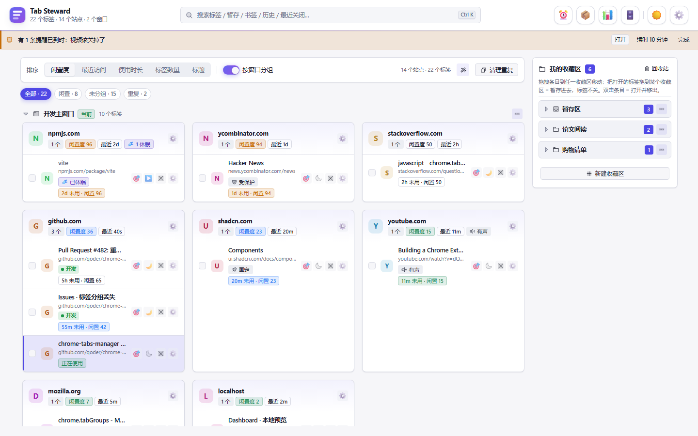</td>
    <td>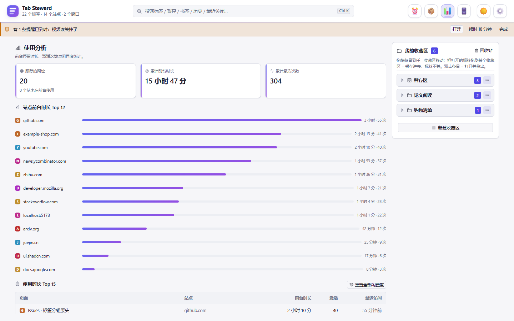</td>
  </tr>
  <tr>
    <td>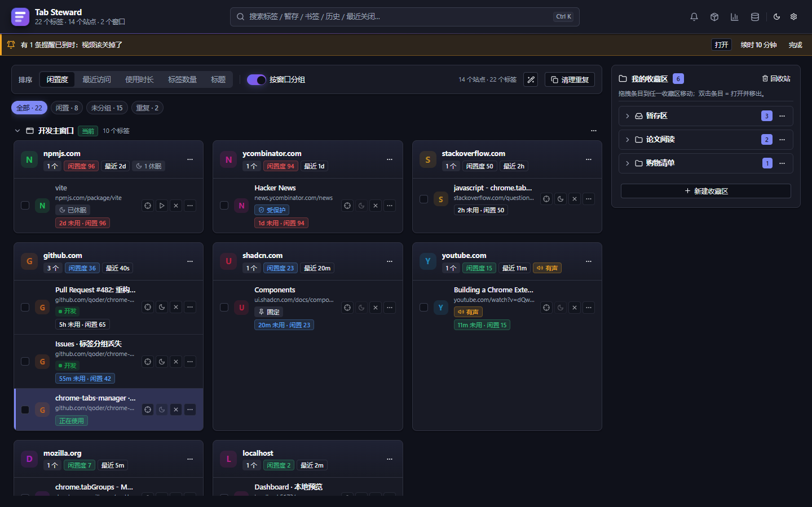</td>
    <td>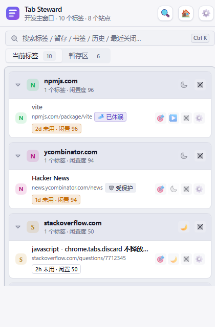</td>
  </tr>
</table>

> **The extension UI is currently Chinese only.** These pages are translated; the interface is not
> (yet). The screenshots above show the real Chinese UI.

Tab Steward measures how long each tab has sat idle, sleeps stale ones, stashes tab sets into named
collections, handles duplicates, snapshots and restores whole workspaces, sets timed reminders, and
searches tabs / stashes / bookmarks / history / recently closed from a single `Ctrl`/`⌘K` palette.
Everything except the open-tab list, the stash and the usage analytics can be switched off. All data
stays in `chrome.storage.local`; the optional LLM helper is off by default and talks only to a base
URL you supply. See [THIRD_PARTY_NOTICES.md](./THIRD_PARTY_NOTICES.md) for icon and style provenance.

## Demos

Every clip below is a screen recording of the real interface driven by the built-in mock
(`src/dev/mock-chrome.js`) with seeded data — nobody's actual browsing history appears in them.

<table>
  <tr>
    <td>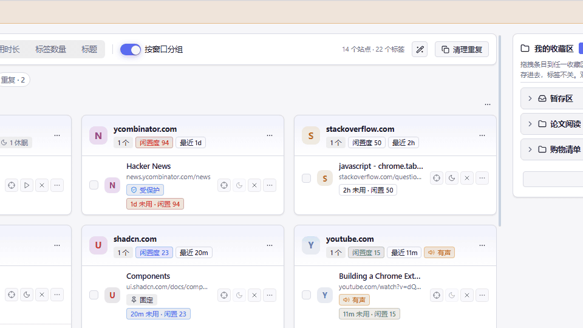<br><b>Unified search</b><br>One <code>⌘K</code> palette across tabs, stashes, bookmarks, history and recently closed.</td>
    <td>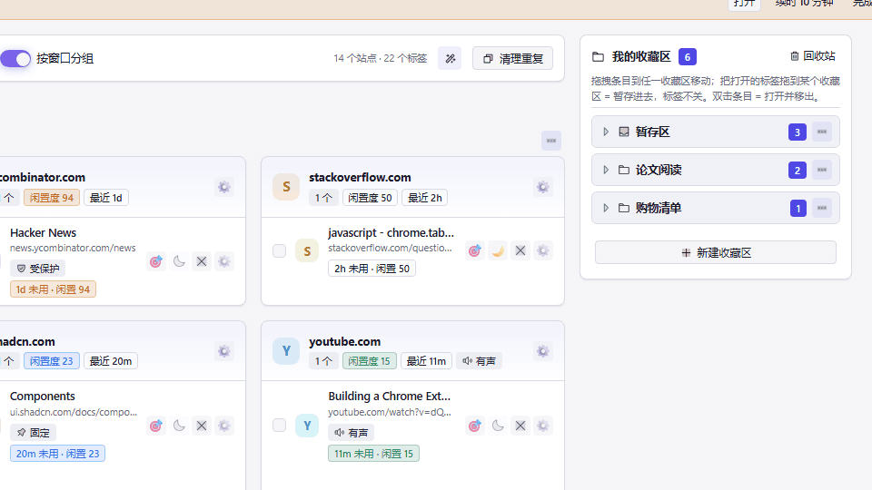<br><b>Drag to stash</b><br>Drop a tab on any collection — collapsed ones take it too — and the tab stays open.</td>
  </tr>
  <tr>
    <td>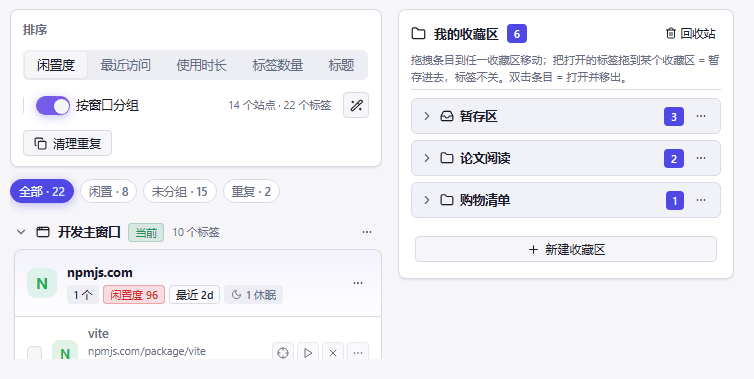<br><b>Sleeping</b><br>Every site carries an idle score; sleep one tab or the whole group.</td>
    <td>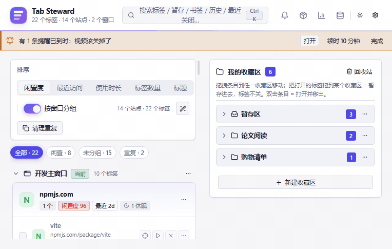<br><b>Duplicates</b><br>Filter down to the duplicates. It only ever prompts — closing stays your call.</td>
  </tr>
  <tr>
    <td>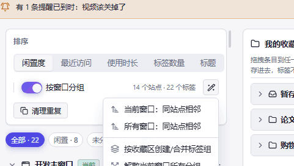<br><b>Auto-organize</b><br>Sites adjacent, or grouped by collection, in one action.</td>
    <td>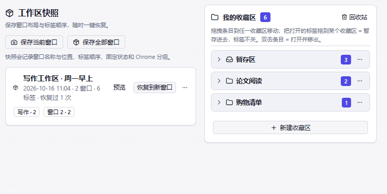<br><b>Workspace snapshots</b><br>Save a window layout with its tab order, restore it whenever.</td>
  </tr>
  <tr>
    <td>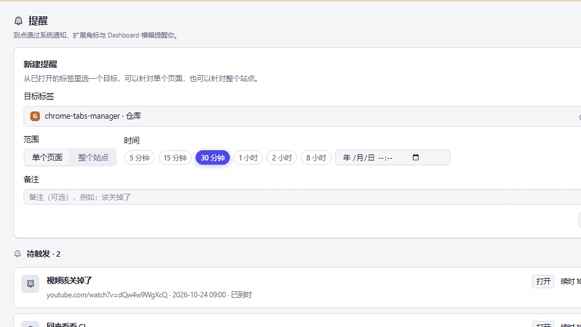<br><b>Timed reminders</b><br>Pick the target from open tabs, set a duration, get a notification with action buttons.</td>
    <td>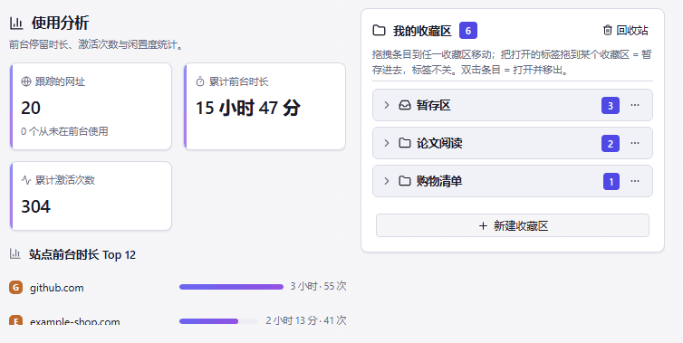<br><b>Usage analytics</b><br>Foreground time and activation counts per site and per page, all local.</td>
  </tr>
</table>

### Right-click menu

The one feature no clip can show: the menu belongs to the browser, not the page. On any page the
context menu carries a "Tab Steward — 标签页管理器" entry (boxed below), and its submenu rebuilds
itself as your collections and windows change.

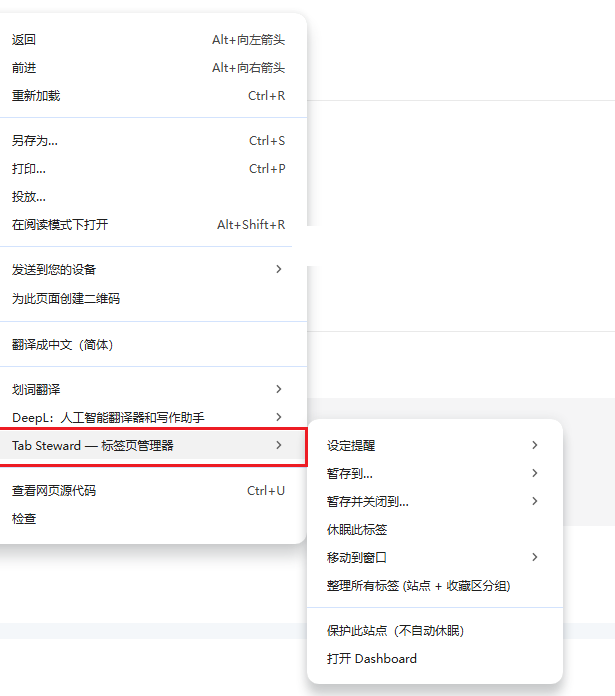

- **设定提醒** — preset durations, for the page or the whole site
- **暂存到…** / **暂存并关闭到…** — both list every collection
- **休眠此标签**
- **移动到窗口** — the other normal windows
- **整理所有标签（站点 + 收藏区分组）**
- **保护此站点（不自动休眠）**
- **打开 Dashboard**

## Install

1. Open `chrome://extensions`
2. Turn on **Developer mode** (top right)
3. Click **Load unpacked** and select this folder
4. The toolbar icon appears — click it for the popup, press `Alt+Shift+T` for the Dashboard

## Surfaces

| Surface | Location | What it holds |
|---|---|---|
| Toolbar popup | `src/popup/` | Unified search (tabs / stashes / bookmarks / history / recently closed); below it, two columns: current tabs and the stash; collapse by site, stash / sleep / close, duplicate cleanup |
| Dashboard | `src/dashboard/` | Top bar = logo + search field + feature buttons; main area = current tabs (sorting / group by window / filter chips / window sections / site cards); right column = always-visible collections panel; reminders, snapshots, analytics and trash switch in from the top-bar icons |
| New tab page | `src/newtab/` | Minimal start page by default; can be switched to the full Dashboard in settings |
| Settings | `src/options/` | Every toggle, plus LLM configuration |

Shortcuts: `Alt+T` popup, `Alt+Shift+T` Dashboard, `Ctrl/⌘+K` unified search.

Right-clicking a page adds a "Tab Steward — 标签页管理器" entry; its submenu is listed, with a
screenshot, under **Right-click menu** in the Demos section above.

## Feature modules and defaults

Apart from the three core capabilities — open-tab management, the stash and usage analytics — every
feature is a switchable module, listed under "Feature modules" at the top of the settings page
(single source of truth: `src/core/modules.js`). **Turning a module off removes every entry point it
owns in the popup, Dashboard, context menu, unified search and settings, and stops its background
work; data is always kept, and switching it back on restores everything.**

Usage analytics is core: the idle score and every sort order in the Dashboard are computed from it,
so switching it off would degrade sorting and therefore has no toggle.

| Module | Default |
|---|---|
| Open-tab management, stash, usage analytics | Core, cannot be disabled |
| Collections, duplicate handling, sleeping, timed reminders, workspace snapshots, auto-organize, bookmarks & history search, trash and backup | On |
| LLM organizing assistant, tab hover screenshots | Off (bring your own model endpoint and key / grant page access on demand) |

When a duplicate shows up Tab Steward only tells you about it — it never closes a tab on your
behalf. Opening the same page twice is an ordinary thing to do (a second form, a side-by-side
comparison), so that call stays yours. Both the notification and the Dashboard banner offer "Close
this and jump" and "Switch to the existing tab"; ignore them and both tabs stay put. Bulk cleanup
("Clean duplicates" in the popup and Dashboard) only runs after you click it, and comes with Undo.

Whether notifications stay on screen (sticky) is a separate setting, on by default: without it,
Windows can dismiss the notification before you see it, and then "Close this and jump" and "Snooze
10 minutes" are unclickable.

`chrome.processes` only exists in Chrome's developer channels and does not work on stable, so there
is no "renderer memory" module and the manifest never requests the `processes` permission.

## Feature → code map

| Feature | Main files |
|---|---|
| Module switches | `src/core/modules.js` (registry), `featureOn()` in `src/ui/shared.js` (read by every surface) |
| Storage and migration | `src/core/storage.js`, `src/core/defaults.js` |
| Usage analytics and idle score | `src/core/stats.js`, `src/background/tracker.js` |
| Sleeping and protection | `src/background/sleep.js`, `src/core/actions.js` |
| Duplicate handling | `src/core/dupes.js`, `src/background/index.js` |
| Auto-organize and tab groups | `src/core/organize.js` |
| Unified search | `src/core/search.js`, `src/ui/shared.js` (the ⌘K panel) |
| Stash and collections | `src/core/collections.js` |
| Bookmarks and history | `src/core/bookmarks.js`, `src/core/history.js` |
| Timed reminders | `src/core/reminders.js` |
| Workspace snapshots | `src/core/snapshots.js` |
| Trash and backup | `src/core/trash.js`, `src/core/backup.js` |
| LLM assistant | `src/core/llm.js` |
| Hover screenshots | `src/background/screenshots.js` (capture and cache), `installHoverPreview()` in `src/ui/shared.js` (display) |
| UI primitives | `src/ui/kit.js`, `src/ui/icons.js`, `src/ui/styles/*` |

## LLM assistant

Speaks the OpenAI `/chat/completions` protocol. Enable "LLM organizing assistant" under Feature
modules in settings first, then fill in Base URL, API Key and model name; the key is stored only in
`chrome.storage.local` on your machine. The request body contains tab titles, domains, idle minutes
and state — never full URLs or history. The model returns topic groupings and sleep suggestions,
which are previewed first and applied only after you confirm; if you don't confirm, nothing changes.

## Permissions

| Permission | Used for |
|---|---|
| tabs / tabGroups / windows | Reading, moving, sleeping and grouping tabs |
| storage / unlimitedStorage | Local data: collections, snapshots, statistics |
| bookmarks / history / sessions | Saving bookmarks, searching history, restoring recently closed |
| notifications / alarms | Triggering reminders and automatic sleeping |
| favicon | Site icons |
| contextMenus | The right-click stash / protect / reminder entries |
| activeTab | Current-tab access when you act on it yourself |
| optional_host_permissions `<all_urls>` | Requested on demand, only when the hover-screenshot module is enabled |

## Privacy

There is no server: no telemetry, analytics, ads or crash reporting, and no endpoint run by the
author. Collections, snapshots, usage statistics, reminders and the trash all live in
`chrome.storage.local` on your machine and disappear with the extension when you uninstall it.

Exactly one outbound request exists, and it is off by default: the LLM organizing assistant. You have
to enter a Base URL and API Key yourself (the key stays local too), and the request body only carries
tab titles, domains, idle minutes and state — no full URLs, no history. The `<all_urls>` used by hover
screenshots is requested on demand; refuse it and nothing is installed.

Bookmarks and history are read locally for search only. The results never leave the browser.

## Development

No dependencies to install.

```bash
node tools/serve.mjs          # local static server, port 8787 by default
node tools/check-imports.mjs  # every named import has a matching export
node tools/scan-undefined-refs.mjs  # the reverse: identifiers used but never imported (e.g. Button)
node tools/make-icons.mjs     # regenerate the icons (pixel self-check; a transparent output fails the run)
node tests/run.mjs            # automated tests for the core logic (46 cases)
node tools/record-demo.mjs    # regenerate the demo GIFs (needs Chrome + ffmpeg)
```

`package.json` holds scripts only, so `npm test` and `npm run check` work out of the box (import
check + undefined-reference scan + tests). The tests run against `tests/chrome-stub.mjs`, a chrome
test double implemented to be as strict as the real API (argument validation, `storage.onChanged`
firing for the writer too, `alarms` naming and query semantics, `tabs.query` rejecting unknown
filters, notification `priority` rejected for negative values exactly as Windows/Linux/macOS each do
it) — which is what makes passing them meaningful.

Open a page such as `http://localhost:8787/src/dashboard/index.html` in a browser and
`src/dev/mock-chrome.js` injects a seeded `chrome.*` implementation (tabs, windows, groups,
bookmarks, history, recently closed, storage), so every surface runs and can be screenshotted without
the extension installed. A MOCK bar appears at the bottom of the page, where you can add tabs or reset
the seed data. Append `?theme=dark` (mock only) to force the dark theme on any page — all four
surfaces then screenshot side by side — and `?nobanner` to drop the bar, which is how the document
screenshots above were made.

## Design tokens

Colours, radii, spacing, shadows and animation durations all live in `src/ui/styles/tokens.css`; the
light and dark themes only change token values. The brand colour is an indigo→violet gradient:
`--primary` is reserved for action and structure (primary buttons, switches, checkboxes, the active
tab underline, filter chips, progress bars, the current-row indicator), while `--gradient-brand` is
used for icons and the stat-card border. Site favicon letter tiles and Chrome's tab-group colours are
data colours, so `TILE_HUES` deliberately avoids the 225–285 hue band to stop site icons from
looking like interface controls. When you add UI, read tokens — don't hardcode colours or `ms`
durations.

Headless screenshot example:

```bash
chrome --headless=new --window-size=1440,900 --virtual-time-budget=4500 \
  --screenshot=out.png "http://localhost:8787/src/dashboard/index.html#tabs"
```

Note: headless mode positions `transform`-centred elements (the search palette, for instance)
unreliably, so verify layout in a headed browser.

## License

The source is licensed under [MIT](./LICENSE). The path data of the interface icons derives from
Lucide (ISC), some of it traceable further back to Feather (MIT); the style primitives reference
shadcn/ui (MIT). Full license terms and copyright notices for all three are in
[THIRD_PARTY_NOTICES.md](./THIRD_PARTY_NOTICES.md) and must be kept when redistributing.
